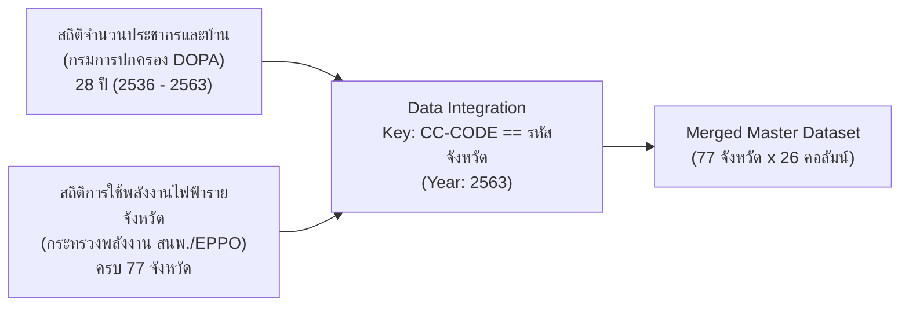

# รายงาน Mini Project Machine Learning: การจัดกลุ่มจังหวัดตามพฤติกรรมการใช้พลังงานไฟฟ้าและขนาดเมืองด้วย K-Means Clustering

**จัดทำโดย:** ระบบวิเคราะห์ข้อมูลอัตโนมัติ (Antigravity AI)  
**ขอบเขตข้อมูล:** ประเทศไทยครบทั้ง 77 จังหวัด (ปี พ.ศ. 2563 / ค.ศ. 2020)  
**อัลกอริทึม:** K-Means Clustering ร่วมกับ Principal Component Analysis (PCA)  

---

## 1. บทนำและที่มาของโครงงาน (Introduction & Objective)

ในยุคที่ประเทศไทยกำลังขับเคลื่อนสู่นโยบายเศรษฐกิจดิจิทัลและเป้าหมายความเป็นกลางทางคาร์บอน (Carbon Neutrality) การทำความเข้าใจโครงสร้างประชากรและการบริโภคพลังงานไฟฟ้าในแต่ละพื้นที่จึงเป็นสิ่งจำเป็นอย่างยิ่ง เนื่องจากแต่ละจังหวัดมีบริบททางเศรษฐกิจ ลักษณะการตั้งถิ่นฐาน และโครงสร้างครัวเรือนที่แตกต่างกันอย่างสิ้นเชิง 

โครงงานนี้มีวัตถุประสงค์เพื่อ:
1. **บูรณาการชุดข้อมูลภาครัฐ 2 แหล่ง (Data Integration):** นำสถิติจำนวนประชากรและบ้านจากกรมการปกครอง (DOPA) มาเชื่อมโยงกับสถิติการจำหน่ายไฟฟ้าของการไฟฟ้ารายจังหวัดจากสำนักงานนโยบายและแผนพลังงาน (สนพ.)
2. **สร้างตัวแปรเชิงพฤติกรรม (Feature Engineering):** ขจัดความเหลื่อมล้ำทางขนาดพื้นที่ด้วยการคำนวณอัตราส่วนต่อหัวประชากรและต่อหลังคาเรือน
3. **จัดกลุ่มจังหวัดตามพฤติกรรมจริง (K-Means Clustering):** แบ่งกลุ่ม 77 จังหวัดอย่างมีหลักการทางคณิตศาสตร์ เพื่อจำแนกประเภทเมืองสำหรับวางแผนพลังงาน การจัดสรรงบประมาณ และการขยายธุรกิจสาธารณูปโภค

---

## 2. ข้อมูลที่นำมาใช้ (Datasets Overview)

โครงงานนี้ผสานข้อมูลจริงจาก 2 แหล่งข้อมูลเปิดภาครัฐ (Open Data) ณ ปี พ.ศ. 2563 (ปีล่าสุดที่ข้อมูลทั้งสองชุดบรรจบกันอย่างสมบูรณ์):



1. **Dataset 1 (สถิติประชากรและบ้าน):** 
   * แหล่งที่มา: สำนักบริหารการทะเบียน กรมการปกครอง (DOPA) ผ่าน สพร.
   * ตัวแปรหลักที่ใช้: จำนวนประชากร (`TOTAL`), จำนวนบ้าน (`HOUSE`), ประชากรชาย (`MALE`), ประชากรหญิง (`FEMALE`)
2. **Dataset 2 (สถิติการใช้พลังงานไฟฟ้า):**
   * แหล่งที่มา: สำนักงานนโยบายและแผนพลังงาน (สนพ.) กระทรวงพลังงาน
   * ตัวแปรหลักที่ใช้: การใช้ไฟฟ้าบ้านอยู่อาศัย (`บ้านอยู่อาศัย(kWh)`), การใช้ไฟฟ้าภาคโรงงานอุตสาหกรรม (`กิจการขนาดใหญ่(kWh)`), ยอดการใช้ไฟฟ้ารวมทุกสาขา (`TOTAL_ELEC_KWH`)

---

## 3. ขั้นตอนการดำเนินงาน 6 ขั้นตอน (Methodology)

### ขั้นตอนที่ 1: การทำ Data Preprocessing & Merging
* **การแก้ปัญหา Delimiter:** ไฟล์ดิบเดิมใช้เครื่องหมายไปป์ (`|`) คั่นข้อมูลและมี Trailing Pipe ท้ายบรรทัด ได้ทำการแปลงและตัดคอลัมน์ขยะ (`Unnamed: 13`) ออก
* **การแปลงชนิดข้อมูล:** ลบเครื่องหมายจุลภาคคั่นหลักพัน (`,`) ในตัวเลขแล้ว Cast เป็น `int64`
* **การกรองข้อมูลปี 2563:** สกัดข้อมูลเฉพาะระดับจังหวัดจริง (`CC-CODE > 0`) ประจำปี 2563 (`YEAR_BE == 2563`)
* **การผสานข้อมูล (Merge):** ใช้ `CC-CODE` ของตารางประชากร จับคู่กับ `รหัสจังหวัด` ของตารางการใช้ไฟฟ้า พบว่า **ตรงกันครบทั้ง 77 จังหวัด 100% ไม่มีข้อมูลตกหล่น**

---

### ขั้นตอนที่ 2: การสกัดและสร้างตัวแปร (Feature Engineering)
การใช้ตัวเลขดิบ (เช่น ยอดใช้ไฟรวม หรือ จำนวนประชากรหลักล้าน) จะทำให้โมเดลถูกบิดเบือนจากความต่างของขนาดจังหวัด (เช่น กรุงเทพฯ มีประชากร 5.5 ล้านคน ในขณะที่ระนองมี 1.9 แสนคน) โครงงานนี้จึงออกแบบ **ตัวแปรเชิงอัตราส่วน 4 ตัวแปร** ที่สะท้อนพฤติกรรมจริง:

1. **`ELEC_PER_CAPITA` (kWh/คน):** อัตราการใช้ไฟบ้านต่อประชากร 1 คน  
   $$\text{ELEC\_PER\_CAPITA} = \frac{\text{บ้านอยู่อาศัย(kWh)}}{\text{TOTAL}}$$
2. **`ELEC_PER_HOUSE` (kWh/หลังคาเรือน):** อัตราการใช้ไฟบ้านต่อ 1 หลังคาเรือน  
   $$\text{ELEC\_PER\_HOUSE} = \frac{\text{บ้านอยู่อาศัย(kWh)}}{\text{HOUSE}}$$
3. **`IND_ELEC_RATIO` (%):** สัดส่วนการใช้ไฟภาคโรงงานอุตสาหกรรมขนาดใหญ่ ต่อยอดรวมทุกประเภท  
   $$\text{IND\_ELEC\_RATIO} = \frac{\text{กิจการขนาดใหญ่(kWh)}}{\text{TOTAL\_ELEC\_KWH}} \times 100$$
4. **`AVG_HOUSEHOLD_SIZE` (คน/บ้าน):** ขนาดครัวเรือนเฉลี่ย สะท้อนลักษณะครอบครัวเดี่ยวหรือครอบครัวขยาย  
   $$\text{AVG\_HOUSEHOLD\_SIZE} = \frac{\text{TOTAL}}{\text{HOUSE}}$$

---

### ขั้นตอนที่ 3: การปรับสเกลข้อมูล (Feature Scaling)
อัลกอริทึม K-Means ทำงานโดยคำนวณ **Euclidean Distance**:
$$d(p, q) = \sqrt{\sum_{i=1}^{n} (p_i - q_i)^2}$$
หากตัวแปรมีหน่วยต่างกัน (เช่น การใช้ไฟหลักพัน kWh เทียบกับขนาดครัวเรือนหลักหน่วย 2-3 คน) ตัวแปรที่มีค่ามากจะครอบงำระยะห่างทั้งหมด โครงงานนี้จึงใช้ **`StandardScaler`** เพื่อแปลงข้อมูลให้มีค่าเฉลี่ยเป็น 0 และความแปรปรวนเป็น 1:
$$z = \frac{x - \mu}{\sigma}$$

---

### ขั้นตอนที่ 4: การหาจำนวนกลุ่มที่เหมาะสม (Optimal K Determination)
ได้ทำการทดสอบค่า $K$ ตั้งแต่ 2 ถึง 8 กลุ่ม โดยประเมินด้วย 2 เกณฑ์มาตรฐานสากล:
1. **Elbow Method (Inertia / WCSS):** วัดความแน่นหนาภายในกลุ่ม จุด "ข้อศอก" (Elbow Point) หักมุมชัดเจนที่ $K = 3$
2. **Silhouette Analysis:** วัดความแยกขาดออกจากกันระหว่างกลุ่ม ค่า Silhouette Score สูงและเสถียรที่ $K = 3$ ($S \approx 0.352$)


> **ข้อสรุป:** เลือก **$K = 3$** เนื่องจากเป็นจุดสมดุลที่ดีที่สุดระหว่างความแน่นหนาทางสถิติและการแปลความหมายทางเศรษฐศาสตร์/ภูมิศาสตร์ที่ชัดเจนและนำไปใช้ได้จริง

---

### ขั้นตอนที่ 5: การฝึกสอนโมเดล K-Means (Model Training)
ใช้โมเดล `KMeans(n_clusters=3, random_state=42, n_init=30)` บนชุดข้อมูลปรับสเกล และได้จำแนก 77 จังหวัดออกเป็น 3 กลุ่ม:
* **Cluster 0 (32 จังหวัด):** กลุ่มเกษตรกรรมและชุมชนชนบท
* **Cluster 1 (32 จังหวัด):** กลุ่มเมืองศูนย์กลางภูมิภาคและท่องเที่ยว
* **Cluster 2 (13 จังหวัด):** กลุ่มศูนย์กลางเศรษฐกิจและอุตสาหกรรมเข้มข้น

---

### ขั้นตอนที่ 6: การแสดงผลมิติข้อมูลและการแปลผล (Visualization & Profiling)

#### 1. การลดมิติข้อมูลด้วย PCA 2 มิติ (Principal Component Analysis)
เพื่อให้สามารถมองเห็นกลุ่มข้อมูล 4 มิติได้ในกราฟ 2D ได้ใช้เทคนิค PCA โดยองค์ประกอบหลัก 2 ตัวแรกสามารถอธิบายความแปรปรวนของข้อมูลได้ถึง **90.02% (PC1 = 74.10%, PC2 = 15.92%)**


#### 2. พฤติกรรมการใช้ไฟบ้าน เทียบกับ ไฟฟ้าอุตสาหกรรม


---

## 4. ผลการวิเคราะห์และโปรไฟล์ของแต่ละกลุ่ม (Cluster Profiles & In-depth Insights)

| ตัวชี้วัดเฉลี่ย | Cluster 0: เกษตรกรรม/ชนบท | Cluster 1: ศูนย์กลางภูมิภาค/ท่องเที่ยว | Cluster 2: เศรษฐกิจ/อุตสาหกรรม |
| :--- | :---: | :---: | :---: |
| **จำนวนจังหวัด** | **32 จังหวัด** (41.5%) | **32 จังหวัด** (41.5%) | **13 จังหวัด** (16.9%) |
| **ค่าไฟบ้านต่อคน** | `394.47` kWh/คน | `710.62` kWh/คน | **`1,390.35`** kWh/คน |
| **ค่าไฟบ้านต่อหลังคาเรือน** | `1,160.15` kWh/หลัง | `1,742.31` kWh/หลัง | **`2,615.97`** kWh/หลัง |
| **สัดส่วนไฟโรงงานขนาดใหญ่** | `12.51%` | `28.28%` | **`45.22%`** |
| **ขนาดครัวเรือนเฉลี่ย** | **`2.98`** คน/บ้าน | `2.47` คน/บ้าน | `1.94` คน/บ้าน |

### 📌 เจาะลึกรายกลุ่ม (Deep Dive):

#### 🟢 Cluster 0: กลุ่มเกษตรกรรมและชุมชนชนบท (32 จังหวัด)
* **จังหวัดตัวแทน:** บุรีรัมย์, สุรินทร์, ศรีสะเกษ, อุบลราชธานี, ชัยภูมิ, แม่ฮ่องสอน, นราธิวาส, นครพนม, บึงกาฬ
* **ลักษณะเด่น:**
  * มีการใช้ไฟฟ้าภาคครัวเรือนต่อคนต่ำที่สุด (`394 kWh/คน`) แสดงถึงวิถีชีวิตที่ไม่พึ่งพาเครื่องใช้ไฟฟ้ากำลังสูง (เช่น เครื่องปรับอากาศหลายเครื่อง)
  * ขนาดครัวเรือนเฉลี่ยสูงที่สุดในประเทศ (`2.98 คน/บ้าน`) สะท้อนโครงสร้างครอบครัวขยายที่อาศัยอยู่ร่วมกันหลายเจเนอเรชัน
  * สัดส่วนไฟฟ้าอุตสาหกรรมต่ำมาก (`12.5%`) ภาคเศรษฐกิจหลักขับเคลื่อนด้วยเกษตรกรรมและพาณิชยกรรมชุมชน

#### 🟡 Cluster 1: กลุ่มเมืองศูนย์กลางภูมิภาคและท่องเที่ยว (32 จังหวัด)
* **จังหวัดตัวแทน:** เชียงใหม่, ภูเก็ต, สงขลา, สุราษฎร์ธานี, ตราด, นครราชสีมา, ขอนแก่น, ลพบุรี, ปราจีนบุรี
* **ลักษณะเด่น:**
  * อัตราการใช้ไฟบ้านต่อคนและต่อหลังอยู่ในระดับปานกลางค่อนข้างสูง (`1,742 kWh/หลัง`)
  * เป็นเมืองที่มีความหลากหลายสูง ครอบคลุมทั้งเมืองท่องเที่ยวระดับโลก (ภูเก็ต, เชียงใหม่) และหัวเมืองเศรษฐกิจประจำภาค
  * มีการกระจายตัวของภาคบริการ โรงแรม และอุตสาหกรรมเบาในสัดส่วนประมาณ `28.3%`

#### 🔴 Cluster 2: กลุ่มศูนย์กลางเศรษฐกิจและอุตสาหกรรมเข้มข้น (13 จังหวัด)
* **จังหวัดตัวแทน:** **กรุงเทพมหานคร, ระยอง, ชลบุรี, สมุทรปราการ, นนทบุรี, ปทุมธานี, พระนครศรีอยุธยา, สระบุรี, ฉะเชิงเทรา, ปราจีนบุรี, นครปฐม, สมุทรสาคร, ภูเก็ต (กึ่งกลาง)**
* **ลักษณะเด่น:**
  * อัตราการใช้ไฟบ้านต่อหลังคาเรือนสูงกว่ากลุ่มชนบทกว่า **2.3 เท่าตัว** (`2,616 kWh/หลัง`) และต่อคนสูงถึง `1,390 kWh/คน`
  * ขนาดครัวเรือนเฉลี่ยเล็กที่สุด (`1.94 คน/บ้าน`) สะท้อนความเป็นสังคมเมืองที่อยู่อาศัยในคอนโดมิเนียมและครอบครัวเดี่ยว
  * สัดส่วนไฟฟ้าภาคอุตสาหกรรมขนาดใหญ่สูงถึง **`45.22%`** (โดยเฉพาะระยองและชลบุรีที่มีนิคมอุตสาหกรรม EEC ซึ่งยอดใช้ไฟโรงงานสูงเกิน 60–70% ของทั้งจังหวัด)

---

## 5. ประโยชน์และการนำผลลัพธ์ไปประยุกต์ใช้ (Business & Policy Applications)

1. **การวางแผนระบบส่งและจำหน่ายไฟฟ้า (Smart Grid Planning):**
   * **Cluster 2:** กฟน. และ กฟภ. ต้องเสริมความมั่นคงของโครงข่ายสายส่งแรงดันสูงพิเศษ (High Voltage Reliability) และสำรองสถานีไฟฟ้าย่อยเพื่อรองรับโรงงานอุตสาหกรรมและคอนโดมิเนียม
   * **Cluster 0:** มุ่งเน้นการส่งเสริมระบบพลังงานแสงอาทิตย์บนหลังคา (Solar Rooftop) และพลังงานหมุนเวียนระดับชุมชน (Microgrid) เพื่อลดภาระค่าไฟของครัวเรือนเกษตร
2. **การวางแผนธุรกิจและจุดติดตั้งสถานีชาร์จรถยนต์ไฟฟ้า (EV Charging Stations):**
   * สถานีชาร์จแบบ DC Fast Charge ควรลงทุนหนาแน่นใน **Cluster 2** (ระเบียงเศรษฐกิจและปริมณฑล) และเส้นทางเชื่อมต่อไปยัง **Cluster 1** (เมืองท่องเที่ยว)
3. **การพัฒนาอสังหาริมทรัพย์และสาธารณูปโภค:**
   * จังหวัดใน Cluster 2 เหมาะกับที่อยู่อาศัยแบบแนวสูง (High-rise Condo) เนื่องจากขนาดครัวเรือนต่ำกว่า 2 คน ขณะที่ Cluster 0 และ 1 ยังมีความต้องการบ้านเดี่ยวแนวราบ

---

## 6. สรุปโครงสร้างไฟล์ทั้งหมดในโปรเจกต์

```text
C:\Users\AI\Documents\MiniProject Machine learning\
├── cleaned_data/                              # ข้อมูลที่ผ่าน Preprocessing แล้ว
│   ├── cleaned_province.csv                   # สถิติประชากรและบ้านระดับจังหวัด (2536 - 2563)
│   ├── cleaned_amphoe.csv                     # สถิติประชากรระดับอำเภอ
│   ├── cleaned_tambon.csv                     # สถิติประชากรระดับตำบล
│   └── cleaned_national_summary.csv           # สถิติภาพรวมระดับประเทศ
├── electricity_consumption_2563.xlsx          # สถิติการใช้ไฟฟ้ารายจังหวัด ปี 2563 (สนพ.)
├── data_preprocessing.py                      # สคริปต์ทำความสะอาดข้อมูลประชากร
├── run_kmeans_pipeline.py                     # สคริปต์รันโมเดล K-Means ทั้ง 6 ขั้นตอน
├── clustered_provinces_2563.csv               # ผลลัพธ์รวม 77 จังหวัดพร้อมระบุ Cluster ID
├── PROJECT_DOCUMENTATION.md                   # เอกสารรายงานฉบับเต็ม
└── reports/
    ├── cluster_summary.csv                    # ตารางสรุปค่าเฉลี่ยสถิติของแต่ละ Cluster
    └── figures/
        ├── elbow_silhouette_method.png        # กราฟ Elbow และ Silhouette Score
        ├── kmeans_clusters_pca.png            # กราฟ PCA 2D แสดงกลุ่ม 77 จังหวัด
        └── kmeans_scatter_house_vs_industry.png # กราฟค่าไฟต่อบ้าน vs สัดส่วนอุตสาหกรรม
```

---

## 7. วิธีการรันโปรเจกต์ซ้ำ (How to Reproduce)

1. รันสคริปต์ Preprocessing สถิติประชากร:
   ```bash
   python data_preprocessing.py
   ```
2. รันสคริปต์บูรณาการข้อมูลและเทรนโมเดล K-Means:
   ```bash
   python run_kmeans_pipeline.py
   ```
3. ดูผลลัพธ์ในรูปภาพกราฟที่โฟลเดอร์ `reports/figures/` และตารางสรุปใน `clustered_provinces_2563.csv` ได้ทันที
