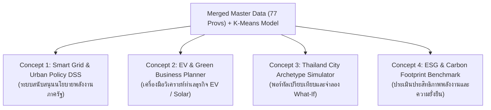

# แผนข้อเสนอโครงการพัฒนาเว็บแอปพลิเคชัน (Web Application Proposal & Development Plan)
## ต่อยอดผลลัพธ์ K-Means Clustering: ข้อมูลประชากรและสถิติการใช้ไฟฟ้า 77 จังหวัด

---

## 1. บทนำและที่มา (Background & Rationale)
จากการนำชุดข้อมูลประชากรและที่อยู่อาศัย (DOPA) มาบูรณาการร่วมกับสถิติการใช้พลังงานไฟฟ้า (EPPO) และจัดกลุ่มด้วย K-Means ออกมาเป็น 3 กลุ่ม:
* **Cluster 0 (เกษตรกรรม/ชนบท):** ครอบครัวใหญ่ ใช้ไฟบ้านต่ำ ไฟโรงงานต่ำ
* **Cluster 1 (ศูนย์กลางภูมิภาค/ท่องเที่ยว):** ใช้ไฟปานกลาง-สูง มีภาคบริการ โรงแรม อุตสาหกรรมขนาดกลาง
* **Cluster 2 (เศรษฐกิจและอุตสาหกรรมเข้มข้น):** ครอบครัวเดี่ยว/คอนโด ใช้ไฟต่อหัวสูงมาก โรงงานใหญ่ใช้ไฟเกิน 45%

อาจารย์ในวิชา Machine Learning มักมองหา **"การสร้างคุณค่าที่จับต้องได้ (Tangible Business / Policy Value)"** และ **"การมีปฏิสัมพันธ์กับโมเดล (Interactive ML)"** ที่ไม่ใช่แค่ Dashboard แสดงกราฟนิ่งๆ

---

## 2. ตัวเลือกคอนเซ็ปต์เว็บแอปพลิเคชัน 4 รูปแบบ (4 App Concepts)



---

### 💡 รูปแบบที่ 1: ระบบสนับสนุนการตัดสินใจวางแผนพลังงานและผังเมือง (Energy & Urban Policy DSS)
> **กลุ่มเป้าหมาย:** กฟภ. (PEA), กฟน. (MEA), กระทรวงพลังงาน, กรมโยธาธิการและผังเมือง  
> **ธีมหลัก:** GovTech / Smart City Planning

#### ฟีเจอร์หลัก (Key Features):
1. **Interactive Thailand Energy Map:** แผนที่ประเทศไทยแบบ Choropleth Map คลิกดูรายจังหวัด แสดงสีตาม Cluster 0, 1, 2 พร้อม Tooltip ตัวเลขสรุป
2. **Infrastructure Recommendation Engine:**
   * **Cluster 2:** แนะนำการลงทุนสถานีไฟฟ้าย่อยแรงดันสูง (Substations), โครงข่าย Smart Grid รองรับโรงงาน
   * **Cluster 0:** แนะนำโครงการส่งเสริม Solar Rooftop ชุมชน หรือ Microgrid เพื่อลดภาระค่าไฟภาคครัวเรือน
3. **Provincial Radar Chart Comparison:** กราฟใยแมงมุมเปรียบเทียบสถิติของ 2-3 จังหวัดที่เลือก เพื่อดูความพร้อมและช่องว่างเชิงโครงสร้างพื้นฐาน

---

### 💡 รูปแบบที่ 2: แพลตฟอร์มวิเคราะห์ทำเลและวางแผนธุรกิจพลังงานสะอาด (Green Energy & EV Station Site Selection Tool) — *[แนะนำเป็นพิเศษ ⭐]*
> **กลุ่มเป้าหมาย:** ภาคเอกชน, ผู้ประกอบการสถานีชาร์จรถยนต์ไฟฟ้า (EV CPO), บริษัทติดตั้งโซลาร์เซลล์, ผู้พัฒนาอสังหาริมทรัพย์  
> **ธีมหลัก:** Business Analytics / Green Economy

#### ฟีเจอร์หลัก (Key Features):
1. **EV Charging Investment Readiness Index:** คำนวณคะแนนความคุ้มค่าในการตั้งสถานีชาร์จ EV โดยอิงจากความหนาแน่นของการใช้ไฟบ้านและโครงสร้างเมือง
   * **Cluster 2:** เหมาะกับ DC Fast Charge ย่านพาณิชย์และคอนโดมิเนียม
   * **Cluster 1:** เหมาะกับสถานีชาร์จตามจุดแวะพักเมืองท่องเที่ยว (Tourism Corridors)
2. **Solar Rooftop Potential Calculator:** เลือกจังหวัด แล้วให้ระบบประเมินความเป็นไปได้ในการติดโซลาร์เซลล์สำหรับบ้านอยู่อาศัย โดยคำนวณจากค่าไฟเฉลี่ยต่อหลังคาเรือน (`ELEC_PER_HOUSE`)
3. **Filter & Export Lead List:** ระบบกรองจังหวัดตามงบประมาณและเป้าหมายธุรกิจ สามารถ Export รายชื่อจังหวัดและสถิติเป็น Excel/PDF Report

---

### 💡 รูปแบบที่ 3: แพลตฟอร์มจำลองสถานการณ์และจัดกลุ่มเมืองอัจฉริยะ (Interactive City Archetype & What-If Simulator)
> **กลุ่มเป้าหมาย:** นักวิจัย, นักเรียน/นักศึกษา, ประชาชนทั่วไป  
> **ธีมหลัก:** Data Science & Interactive Machine Learning

#### ฟีเจอร์หลัก (Key Features):
1. **Interactive What-If Scenario Simulator (ฟีเจอร์เด่นเรียกคะแนน):**
   * ให้ผู้ใช้ปรับแถบเลื่อน (Sliders) จำลองตัวเลข เช่น *"ถ้าจังหวัดกาญจนบุรีมีโรงงานอุตสาหกรรมเพิ่มขึ้นจนสัดส่วนเป็น 40% และประชากรเพิ่มขึ้น 15% จะเปลี่ยนกลุ่มจาก Cluster 1 ไปเป็น Cluster 2 หรือไม่?"*
   * เว็บจะส่งค่าเข้าโมเดล `kmeans.predict()` แล้วแสดงผลทันทีว่าจังหวัดจะขยับไปอยู่กลุ่มไหนใน PCA Space
2. **PCA 2D Dynamic Plot:** พล็อตจุดจังหวัดบนกราฟ PCA แบบ Interactive นำเมาส์ไปชี้เพื่อดูชื่อจังหวัดและสถิติ
3. **Cluster Drill-Down Exploration:** เจาะลึกดูสถิติรายอำเภอและตำบล (ดึงไฟล์ `cleaned_amphoe.csv` และ `cleaned_tambon.csv` มาเสริมให้ครบวงจร)

---

### 💡 รูปแบบที่ 4: พอร์ทัลประเมินความยั่งยืนและการปล่อยคาร์บอน (Provincial Carbon & Energy Benchmark)
> **กลุ่มเป้าหมาย:** องค์กรสิ่งแวดล้อม (TGO), ฝ่าย CSR ของบริษัทเอกชน, นักวางแผน ESG  
> **ธีมหลัก:** Net Zero / ESG Sustainability

#### ฟีเจอร์หลัก (Key Features):
1. **Estimated Carbon Emission:** คำนวณค่าประมาณการปล่อยก๊าซเรือนกระจกจากปริมาณการใช้ไฟฟ้า (Grid Emission Factor: ~0.4999 kgCO2e/kWh)
2. **Carbon Intensity per Capita:** จัดอันดับจังหวัดที่มีความเข้มข้นของการปล่อยคาร์บอนต่อหัวประชากร
3. **Decarbonization Roadmap Generator:** ระบบสรุปข้อเสนอแนะในการลดการปล่อยก๊าซเรือนกระจกเฉพาะกลุ่มจังหวัด

---

## 3. สถาปัตยกรรมระบบและ Tech Stack ที่แนะนำ

### ทางเลือกที่ A: พัฒนารวดเร็ว เน้นงาน Data Science (แนะนำมากที่สุดสำหรับ Mini Project)
* **Framework:** **Streamlit** (Python ล้วน)
* **ข้อดี:**
  * ใช้ Python ที่มีสคริปต์ `run_kmeans_pipeline.py` อยู่แล้ว ไม่ต้องเขียน Frontend แยก
  * มีวิดเจ็ตสำเร็จรูป เช่น Sliders, Dropdowns, Metric Cards, Plotly Interactive Charts
  * ทำแผนที่ประเทศไทยด้วย `Folium` หรือ `Plotly Choropleth` ได้ง่ายมาก
  * ใช้เวลาพัฒนาสั้น (1–3 วัน) สามารถส่งอาจารย์ได้ทันเวลา

### ทางเลือกที่ B: Full-Stack Web Application (หากต้องการเน้นทักษะ Web Dev)
* **Frontend:** React / Next.js หรือ Vue.js + TailwindCSS + Leaflet / Mapbox
* **Backend:** FastAPI (Python) ให้บริการ REST API เช่น `/api/provinces`, `/api/predict-cluster`, `/api/stats`
* **Machine Learning:** Scikit-learn โหลดโมเดลผ่าน `joblib` หรือ `pickle`

---

## 4. โครงสร้างหน้าจอเว็บแอปที่ควรมี (Wireframe / Page Layout)

```text
+-----------------------------------------------------------------------------------+
|  [LOGO] THAILAND ENERGY & URBAN PROFILER (K-MEANS ML PLATFORM)                     |
+-----------------------------------------------------------------------------------+
|  [Tab 1: ภาพรวมแผนที่ 77 จังหวัด] | [Tab 2: เปรียบเทียบรายจังหวัด] | [Tab 3: What-If Simulator]  |
+-----------------------------------------------------------------------------------+
|                                                                                   |
|  [ Left Sidebar: ตัวกรอง ]           [ Main Content Area: Interactive Map ]       |
|  - เลือกปี: [ 2563 ]                  - แผนที่ประเทศไทยแยกสีตาม 3 Cluster         |
|  - เลือกกลุ่ม Cluster:                 - คลิกที่จังหวัดเพื่อดู Summary Modal       |
|    [v] 0: เกษตรกรรม/ชนบท                                                          |
|    [v] 1: เมืองศูนย์กลางท่องเที่ยว                                                |
|    [v] 2: อุตสาหกรรม/เศรษฐกิจ         [ Bottom Section: Key Metrics ]              |
|                                       - ค่าไฟเฉลี่ยต่อหลังคาเรือน: 1,844 kWh     |
|                                       - สัดส่วนไฟอุตสาหกรรมเฉลี่ย: 28.5%           |
|                                       - ขนาดครัวเรือนเฉลี่ย: 2.58 คน              |
+-----------------------------------------------------------------------------------+
```

---

## 5. จุดขายสำคัญที่ควรเตรียมพูดนำเสนอกับอาจารย์ (Key Pitching Points)

1. **มากกว่าการทำรายงานทั่วไป (Beyond Static Report):** การทำเป็น Web App ทำให้ผลลัพธ์ของ Machine Learning ไม่ได้นอนนิ่งอยู่ในไฟล์ CSV หรือสไลด์ แต่กลายเป็นซอฟต์แวร์ที่ผู้มีอำนาจตัดสินใจนำไปใช้งานจริงได้
2. **การบูรณาการข้อมูลต่างมิติ (Cross-Domain Data Integration):** แสดงให้เห็นความสามารถในการเชื่อมข้อมูลประชากร (สังคม) กับข้อมูลการใช้ไฟฟ้า (พลังงานและโครงสร้างพื้นฐาน)
3. **Interactive Inference (การทดลองจำลองตัวเลขจริง):** ฟีเจอร์ What-If Simulation พิสูจน์ว่าผู้พัฒนาเข้าใจหลักการทำงานของโมเดล K-Means และการ Scaling อย่างแท้จริง ไม่ใช่แค่ก็อปปี้โค้ดมารัน
