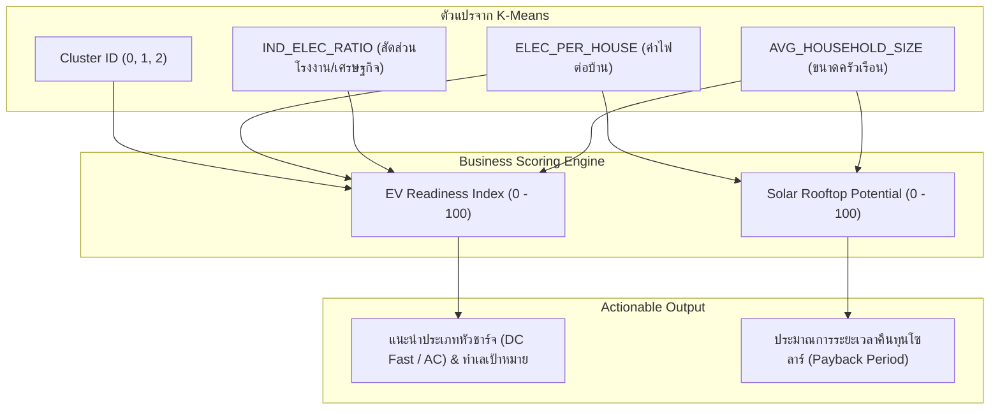

# แผนการพัฒนาอย่างละเอียด: Green Energy & EV Station Site Selection Tool
## เว็บแอปพลิเคชันวิเคราะห์ทำเลและวางแผนธุรกิจสถานีชาร์จ EV & Solar Rooftop จากโมเดล K-Means

---

## 1. ข้อมูลภาพรวมของระบบ (Project Summary)

| หัวข้อ | รายละเอียด |
| :--- | :--- |
| **ชื่อโปรเจกต์** | **Thailand Green Energy & EV Site Selection Planner** |
| **ประเภทระบบ** | Data-driven Decision Support System (Web Application) |
| **เทคโนโลยีหลัก** | Python, Streamlit, Plotly, Pandas, Scikit-Learn |
| **ชุดข้อมูลตั้งต้น** | `clustered_provinces_2563.csv` (ประชากร DOPA + ปริมาณไฟฟ้า EPPO รวม 77 จังหวัด) |
| **กลุ่มผู้ใช้งาน** | ผู้ประกอบการสถานีชาร์จ EV (CPO), บริษัทติดตั้งโซลาร์เซลล์ (EPC), ผู้พัฒนาอสังหาริมทรัพย์, นักวิเคราะห์การลงทุน |

---

## 2. สูตรและลอจิกการคำนวณทางธุรกิจ (Business Scoring Engine)

ระบบจะนำตัวแปรจากโมเดล K-Means มาแปลงเป็น **2 ดัชนีชี้วัดความคุ้มค่าทางธุรกิจ (Business Index)**:



### 1) ดัชนีความพร้อมสถานีชาร์จ EV (EV Readiness Index: 0–100)
คำนวณจาก Weighted Sum ถ่วงน้ำหนัก 4 ปัจจัย:
* **ความเข้มข้นของการใช้พลังงานในบ้าน (`ELEC_PER_HOUSE_norm`) (น้ำหนัก 35%):** บ้านที่ใช้ไฟเยอะ สะท้อนถึงกำลังซื้อเครื่องใช้ไฟฟ้าสูงและมีแนวโน้มซื้อรถยนต์ไฟฟ้า
* **ความคึกคักทางเศรษฐกิจ (`IND_ELEC_RATIO_norm`) (น้ำหนัก 25%):** พื้นที่อุตสาหกรรมและศูนย์กลางเศรษฐกิจที่มีการเดินทางของรถยนต์หนาแน่น
* **กลุ่ม Cluster ที่โมเดลจัดให้ (`Cluster Weight`) (น้ำหนัก 25%):**
  * Cluster 2 (ศูนย์กลางเศรษฐกิจ/อุตสาหกรรม) = 1.00
  * Cluster 1 (ศูนย์กลางภูมิภาค/ท่องเที่ยว) = 0.75
  * Cluster 0 (ชนบท/เกษตรกรรม) = 0.40
* **ความเป็นสังคมเมือง (`1 / AVG_HOUSEHOLD_SIZE_norm`) (น้ำหนัก 15%):** ครัวเรือนขนาดเล็ก (คอนโด/ครอบครัวเดี่ยว) มักมีข้อจำกัดในการติดมิเตอร์ชาร์จที่บ้าน จึงต้องพึ่งพาสถานีชาร์จสาธารณะสูง

#### เกณฑ์คำแนะนำประเภทหัวชาร์จ:
* **คะแนน 80–100 (Tier 1: High Priority):** แนะนำสถานี **DC Fast Charge (120–150 kW)** เน้นจุดติดตั้งในศูนย์การค้า, ปั๊มน้ำมันสายหลัก, และย่านคอนโดมิเนียม
* **คะแนน 60–79 (Tier 2: Medium Priority):** แนะนำสถานีแบบผสม **DC Fast (50–60 kW) ร่วมกับ AC (22 kW)** เน้นตามโรงแรม, รีสอร์ต, และจุดแวะพักเมืองท่องเที่ยว
* **คะแนนต่ำกว่า 60 (Tier 3: Normal Priority):** แนะนำ **AC Destination Charge (7–22 kW)** ตามสถานที่ราชการหรือพื้นที่ชุมชน

---

### 2) ศักยภาพโซลาร์เซลล์หลังคาบ้าน (Solar Rooftop Potential: 0–100)
* คำนวณจากปริมาณการใช้ไฟบ้านต่อหลังคาเรือน (`ELEC_PER_HOUSE`)
* **สูตรประเมินการคืนทุน (Estimated Payback Period):**
  $$\text{Payback (ปี)} \approx \frac{\text{ต้นทุนติดตั้งระบบ 3-5 kW (~150,000 บาท)}}{\text{มูลค่าไฟฟ้าที่ประหยัดได้ต่อปี}}$$
  * กลุ่มบ้านที่ใช้ไฟสูง (> 2,500 kWh/ปี): คืนทุนไวภายใน **4.2 – 5.5 ปี**
  * กลุ่มบ้านที่ใช้ไฟปานกลาง (1,500 – 2,500 kWh/ปี): คืนทุนประมาณ **5.5 – 7.5 ปี**

---

## 3. โครงสร้างหน้าจอการใช้งาน (UI/UX Layout)

แบ่งออกเป็น **4 ส่วนหลัก** ภายในหน้าเดียว (Single Page Dashboard):

```text
=====================================================================================
                      ⚡ THAILAND GREEN ENERGY & EV PLANNER
        ระบบวิเคราะห์ทำเลและวางแผนธุรกิจพลังงานสะอาดจาก Machine Learning
=====================================================================================

[ 🎛️ SIDEBAR CONTROLS ]               [ 📊 MAIN DASHBOARD AREA ]
----------------------------------     ----------------------------------------------
* เลือกโหมดธุรกิจ:                      1. 🏆 KPI Highlight Cards (สถิติภาพรวม)
  ( ) สถานีชาร์จ EV (EV Charging)       - จังหวัดความพร้อมสูงสุด: [ ระยอง / 94.2 ]
  ( ) โซลาร์รูฟท็อป (Solar Rooftop)      - ค่าความพร้อมเฉลี่ยทั้งประเทศ: [ 58.4 ]
                                        - จำนวนจังหวัด Tier 1 (คุ้มค่าสูง): [ 13 จังหวัด ]
* ตัวกรองระดับกลุ่ม (Cluster Filter):
  [x] Cluster 2: อุตสาหกรรม/เศรษฐกิจ    2. 🗺️ Interactive Map & Top Ranking
  [x] Cluster 1: ท่องเที่ยว/ศูนย์กลาง      - ซ้าย: แผนที่ประเทศไทยแยกเฉดสีตามคะแนนความพร้อม
  [x] Cluster 0: ชนบท/เกษตร              - ขวา: ตารางจัดอันดับ Top 10 ทำเลทอง + ปุ่ม Export CSV

* ปรับน้ำหนักการวิเคราะห์ (Sliders):      3. 🔍 Province Deep-Dive (วิเคราะห์เจาะลึกรายจังหวัด)
  - กำลังซื้อครัวเรือน: [ 35% ]            - Dropdown เลือกจังหวัดที่สนใจ (เช่น "เชียงใหม่")
  - ความคึกคักเศรษฐกิจ: [ 25% ]          - Radar Chart เปรียบเทียบกับค่าเฉลี่ยทั้งประเทศ
                                        - Strategy Card: สรุปคำแนะนำชนิดหัวชาร์จ / โซลาร์

                                       4. 💡 What-If Investment Simulator
                                        - ทดลองปรับงบลงทุน หรือจำลองการเติบโตของเมือง
=====================================================================================
```

---

## 4. โครงสร้างไฟล์และโค้ดที่จะสร้างขึ้น

```text
ML-Miniproject/
├── app.py                      # โค้ดหน้าเว็บ Streamlit หลัก (UI + Charts + Interactivity)
├── business_engine.py          # โค้ดสูตรคำนวณคะแนน EV & Solar และคำแนะนำเชิงกลยุทธ์
├── requirements.txt            # รายการไลบรารีที่ต้องใช้ (streamlit, plotly, pandas, etc.)
└── datasets/
    └── clustered_provinces_2563.csv # ไฟล์ข้อมูล 77 จังหวัดที่มี Cluster Label แล้ว
```

---

## 5. แผนการดำเนินงาน 5 ขั้นตอน (Implementation Steps)

### ขั้นที่ 1: ติดตั้งไลบรารีเพิ่มเติม
ติดตั้งเครื่องมือสำหรับเว็บแอปและกราฟแบบ Interactive:
```bash
pip install streamlit plotly openpyxl seaborn
```

### ขั้นที่ 2: สร้างไฟล์โมดูลคำนวณธุรกิจ (`business_engine.py`)
* เขียนฟังก์ชัน `calculate_ev_readiness_score(df)` แปลงตัวเลขเป็นคะแนน 0–100
* เขียนฟังก์ชัน `calculate_solar_potential(df)` ประเมินระยะเวลาคืนทุน
* เขียนฟังก์ชัน `get_strategic_recommendation(row)` เพื่อสร้างข้อความแนะนำการลงทุนแบบเฉพาะบุคคล/เฉพาะจังหวัด

### ขั้นที่ 3: สร้างหน้าเว็บแอปพลิเคชัน (`app.py`)
* วาง Layout ด้วย `st.set_page_config(layout="wide")`
* ใส่ Sidebar เลือกโหมด (EV Mode vs Solar Mode)
* แสดง KPI Metrics การ์ดด้านบน
* สร้างแผนที่ประเทศไทยแบบ Interactive ด้วย Plotly หรือตาราง Bar Chart จัดอันดับ
* สร้างหน้าวิเคราะห์เจาะลึกรายจังหวัด พร้อม Radar Chart เปรียบเทียบ
* ใส่ปุ่ม `st.download_button` ให้ Export รายชื่อจังหวัดและคะแนนออกมาเป็นไฟล์ CSV

### ขั้นที่ 4: ทดสอบการทำงาน (Testing & Verification)
* สั่งรัน `streamlit run app.py`
* ทดสอบการคลิกเปลี่ยนตัวกรอง, เลือกดูรายจังหวัด, ทดสอบปุ่มดาวน์โหลด
* ตรวจสอบว่าตัวเลขสอดคล้องกับสถิติใน `clustered_provinces_2563.csv`

### ขั้นที่ 5: สรุปบทพูดนำเสนอสำหรับอาจารย์ (Presentation Script)
* ไกด์ไลน์ 3 นาทีในการพรีเซนต์:
  1. *โจทย์:* นำ Clustering มาทำให้เห็นมูลค่าทางธุรกิจจริง ไม่ใช่แค่วิชาการ
  2. *เดโม:* เปิดเว็บ โชว์แผนที่ เลือกลงทุนสถานีชาร์จ EV ใน Cluster 2 vs Cluster 1
  3. *ข้อสรุป:* ประโยชน์ต่อการขับเคลื่อนนโยบาย EV ในประเทศไทย
