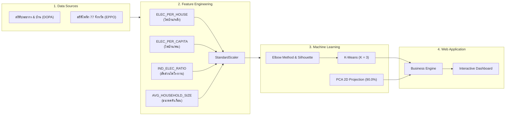

# 🇹🇭 รายงานสรุปโครงการและการนำเสนอ: Thailand Green Energy & EV Site Selection Planner
## ระบบสนับสนุนการตัดสินใจเชิงธุรกิจพลังงานสะอาดและสถานีชาร์จ EV จากโมเดล Unsupervised Machine Learning (K-Means Clustering)

---

## 1. ข้อมูลภาพรวมโครงการ (Executive Summary)

### 📌 1.1 ที่มาและปัญหา (Problem Statement)
การขยายตัวของยานยนต์ไฟฟ้า (Electric Vehicles: EV) และการติดตั้งพลังงานทดแทน (Solar Rooftop) ในประเทศไทยกำลังเติบโตอย่างก้าวกระโดด อย่างไรก็ตาม **ผู้ประกอบการและนักลงทุน (CPO - Charge Point Operators และ EPC - Solar Contractors)** มักประสบปัญหาสำคัญคือ:
1. **ขาดข้อมูลเชิงประจักษ์ (Empirical Evidence) ในระดับพื้นที่:** ไม่ทราบว่าจังหวัดใดมีความพร้อม ความต้องการใช้ไฟฟ้า หรือกำลังซื้อที่คุ้มค่าแก่การลงทุนก่อน
2. **ความเสี่ยงจากการลงทุนผิดทำเล:** การติดตั้งสถานีชาร์จแบบ Ultra Fast DC ที่มีต้นทุนสูงหลักล้านบาทในพื้นที่ที่ไม่มีผู้ใช้งาน หรือการติดตั้งหัวชาร์จช้าในย่านที่มีการจราจรหนาแน่น ส่งผลให้ระยะเวลาคืนทุนนานเกินจริง
3. **ช่องว่างระหว่างโมเดล Machine Learning ทางทฤษฎีกับการประยุกต์ใช้เชิงธุรกิจ:** งานวิจัยส่วนใหญ่หยุดอยู่ที่การจัดกลุ่มข้อมูล (Clustering) บนตารางตัวเลข แต่ไม่มีเครื่องมือช่วยให้ผู้บริหารหรือนักวางแผนนโยบายสามารถนำผลลัพธ์ไปตัดสินใจได้ทันที

### 🎯 1.2 วัตถุประสงค์ของระบบ (Objectives)
1. **บูรณาการชุดข้อมูลขนาดใหญ่ของภาครัฐ (Open Government Big Data):** รวมสถิติประชากร-ทะเบียนบ้าน (DOPA) และสถิติการใช้พลังงานไฟฟ้ารายสาขา (EPPO) ครอบคลุมทั้ง **77 จังหวัด** ในปีฐาน พ.ศ. 2563
2. **สร้างโมเดลจัดกลุ่มจังหวัดด้วย Machine Learning (K-Means Clustering & PCA):** จำแนกกลุ่มพฤติกรรมการใช้พลังงานและลักษณะทางกายภาพของเมืองอย่างเป็นกลางโดยไม่ใช้ความรู้สึกส่วนตัว
3. **พัฒนา Business Scoring Engine:** แปลงผลการวิเคราะห์สถิติทางคณิตศาสตร์ให้กลายเป็น **ดัชนีคะแนนความพร้อม (EV Readiness Index & Solar Potential: 0–100)** 
4. **สร้างระบบตัดสินใจเชิงโต้ตอบ (Interactive Decision Support Dashboard):** เผยแพร่ผ่าน Web Application ที่ใช้งานง่าย พร้อมระบบจำลองสถานการณ์ล่วงหน้า (**What-If Simulator**)

---

## 2. กระบวนการวิทยาการข้อมูลและ Machine Learning Pipeline



### 🔢 2.1 Feature Engineering (4 ตัวแปรหลักที่ใช้สอนโมเดล)
เราไม่ได้นำตัวเลขดิบมาคำนวณโดยตรงเนื่องจากจังหวัดใหญ่ (เช่น กรุงเทพฯ, นครราชสีมา) จะมีประชากรสูงกว่าจังหวัดเล็กมาก จึงได้สร้าง **ตัวแปรเชิงอัตราส่วน (Intensive Ratios)** 4 มิติ:

1. **`ELEC_PER_HOUSE` (kWh/หลัง):** ปริมาณการใช้ไฟฟ้าเฉลี่ยต่อหนึ่งหลังคาเรือน สะท้อนถึงขนาดที่อยู่อาศัย กำลังซื้อ เครื่องใช้ไฟฟ้า และความพร้อมต่อการติด Solar Rooftop หรือ Home EV Charger
2. **`ELEC_PER_CAPITA` (kWh/คน):** ปริมาณการใช้ไฟฟ้าเฉลี่ยต่อหัวประชากร สะท้อนระดับความเจริญและการบริโภคพลังงานรายบุคคล
3. **`IND_ELEC_RATIO` (%):** สัดส่วนการใช้ไฟฟ้าในภาคธุรกิจและอุตสาหกรรมเทียบกับการใช้ไฟทั้งหมด สะท้อนความเป็นศูนย์กลางเศรษฐกิจและโรงงานอุตสาหกรรม
4. **`AVG_HOUSEHOLD_SIZE` (คน/บ้าน):** ขนาดครัวเรือนเฉลี่ย ตัวเลขยิ่งต่ำ (1.5 - 2.0 คน) สะท้อนถึงความเป็นสังคมเมืองสูง (คนอยู่คอนโดมิเนียม/ครอบครัวเดี่ยว) ซึ่งมีข้อจำกัดในการชาร์จไฟที่บ้าน จึงต้องพึ่งพา **สถานีชาร์จสาธารณะ (Public EV Charging)** สูงที่สุด

---

## 3. ทำไมถึงจัดกลุ่มเป็น Cluster 0, 1, 2 ? (การตีความผลลัพธ์ K-Means)

จากการทดสอบด้วย **Elbow Method (Inertia Curve)** ร่วมกับ **Silhouette Score** พบว่า **$K = 3$** เป็นจุดตัดที่มีความเหมาะสมและอธิบายพฤติกรรมโครงสร้างพลังงานของประเทศไทยได้ชัดเจนที่สุด:

### 📊 ตารางเปรียบเทียบค่าเฉลี่ยสถิติของแต่ละกลุ่ม (Cluster Centroids)

| มิติสถิติ | Cluster 0 (ชนบท/เกษตรกรรม) | Cluster 1 (ท่องเที่ยว/บริการ) | Cluster 2 (เศรษฐกิจ/อุตสาหกรรม) |
| :--- | :---: | :---: | :---: |
| **จำนวนจังหวัด** | **32 จังหวัด** (41.5%) | **32 จังหวัด** (41.5%) | **13 จังหวัด** (16.9%) |
| **ค่าไฟบ้าน/หลัง (`ELEC_PER_HOUSE`)** | 1,160 kWh *(ต่ำสุด)* | 1,742 kWh *(ปานกลาง)* | **2,616 kWh** *(สูงสุด)* |
| **ค่าไฟบ้าน/คน (`ELEC_PER_CAPITA`)** | 394 kWh *(ต่ำสุด)* | 711 kWh *(ปานกลาง)* | **1,390 kWh** *(สูงสุด)* |
| **สัดส่วนไฟโรงงาน (`IND_ELEC_RATIO`)** | 12.5% *(ต่ำสุด)* | 28.3% *(ปานกลาง)* | **45.2%** *(สูงสุด)* |
| **ขนาดครัวเรือน (`AVG_HOUSEHOLD_SIZE`)** | **2.98 คน/บ้าน** *(ครอบครัวใหญ่)* | 2.47 คน/บ้าน | **1.94 คน/บ้าน** *(สังคมเมือง/คอนโด)* |

---

### 🔍 วิเคราะห์เจาะลึก 3 กลุ่มพฤติกรรม

#### 🌾 1. Cluster 0: เกษตรกรรมและชุมชนชนบท (Rural & Agricultural Hub) - 32 จังหวัด
* **จังหวัดตัวอย่าง:** แม่ฮ่องสอน, สุรินทร์, บุรีรัมย์, ศรีสะเกษ, ยโสธร, น่าน, ชัยภูมิ
* **ลักษณะทางกายภาพ:** ประชากรอาศัยอยู่เป็นครอบครัวขยาย (ขนาดครัวเรือนเกือบ 3 คน/บ้าน) รายได้และการใช้พลังงานไฟฟ้าเฉลี่ยต่ำ กิจกรรมทางเศรษฐกิจพึ่งพาภาคเกษตรกรรม โรงงานอุตสาหกรรมมีน้อยมาก (12.5%)
* **นัยสำคัญทางธุรกิจ:**
  * **สถานีชาร์จ EV:** กำลังซื้อรถ EV ยังไม่สูง ไม่คุ้มค่าที่จะลงทุนเครื่องชาร์จกำลังไฟสูงราคาแพง ควรติดตั้งเป็น **AC Destination Charge (7–22 kW)** ในอำเภอเมืองหรือสถานที่ราชการเพื่อรองรับผู้เดินทางข้ามถิ่น
  * **โซลาร์เซลล์:** คืนทุนช้า (6.5 - 8.0 ปี) เพราะค่าไฟบ้านต่อเดือนไม่สูง เหมาะกับโซลาร์ภาคเกษตรกรรมเพื่อสูบน้ำชลประทานมากกว่า

#### 🏖️ 2. Cluster 1: เมืองศูนย์กลางภูมิภาคและท่องเที่ยว (Urban & Tourism Hub) - 32 จังหวัด
* **จังหวัดตัวอย่าง:** เชียงใหม่, ภูเก็ต, ขอนแก่น, สงขลา, พิษณุโลก, นครราชสีมา, เชียงราย
* **ลักษณะทางกายภาพ:** มีเมืองขนาดใหญ่ ประชากรหนาแน่น มีกิจกรรมบริการ โรงแรม การท่องเที่ยว และพาณิชยกรรมคึกคัก มีการใช้ไฟฟ้าเฉลี่ยระดับปานกลางค่อนไปทางสูง
* **นัยสำคัญทางธุรกิจ:**
  * **สถานีชาร์จ EV:** มีการเดินทางข้ามจังหวัดและการท่องเที่ยวสูง ผู้ขับขี่ต้องการชาร์จระหว่างแวะพักหรือค้างคืน แนะนำระบบแบบผสมผสาน **Fast DC (50–60 kW) ร่วมกับ AC 22 kW** ติดตั้งตามโรงแรม รีสอร์ต ห้างท้องถิ่น และจุดแวะพักทางหลวง
  * **โซลาร์เซลล์:** คุ้มค่าน่าลงทุน มีระยะเวลาคืนทุนเฉลี่ย **5.0 – 6.5 ปี**

#### 🏭 3. Cluster 2: ศูนย์กลางเศรษฐกิจและอุตสาหกรรม (Industrial & Metropolitan Hub) - 13 จังหวัด
* **รายชื่อทั้ง 13 จังหวัด:** กรุงเทพมหานคร, สมุทรปราการ, นนทบุรี, ปทุมธานี, พระนครศรีอยุธยา, สระบุรี, ชลบุรี, ระยอง, จันทบุรี, ฉะเชิงเทรา, นครปฐม, สมุทรสาคร, ภูเก็ต
* **ลักษณะทางกายภาพ:** รวมเมืองหลวง เขตปริมณฑล และพื้นที่ระเบียงเศรษฐกิจพิเศษ (EEC) การใช้ไฟฟ้าภาคอุตสาหกรรมและพาณิชย์สูงลิ่ว (45.2%) ประชากรอาศัยอยู่ในคอนโดมิเนียม หอพัก หรือบ้านเดี่ยวคนทำงานเมือง (ขนาดครัวเรือนเฉลี่ยเพียง 1.94 คน)
* **นัยสำคัญทางธุรกิจ:**
  * **สถานีชาร์จ EV:** เป็น **"ทำเลทอง Tier 1 (High Priority)"** ที่มีสัดส่วนผู้ใช้รถ EV สูงที่สุด และคนอยู่คอนโดมิเนียมไม่สามารถติดเครื่องชาร์จเองที่บ้านได้ จึงต้องพึ่งพาแท่นชาร์จสาธารณะที่มีความเร็วสูง แนะนำ **Ultra Fast DC (120–150 kW)** ในปั๊มน้ำมันสายหลัก ศูนย์การค้าขนาดใหญ่ และจุดเชื่อมต่อคมนาคม
  * **โซลาร์เซลล์:** คืนทุนเร็วที่สุดภายใน **4.0 – 5.0 ปี** เนื่องจากค่าไฟบ้านและค่าไฟโรงงานสูงมาก

---

## 4. โครงสร้างและการทำงานของหน้าเว็บแอปพลิเคชัน (Web Walkthrough)

หน้าเว็บถูกออกแบบตามหลัก **Human-Centered Dashboard UI** คลีน หรูหรา สไตล์ Green Energy Modern Dashboard แบ่งออกเป็น 5 ส่วนสำคัญ:

```text
+---------------------------------------------------------------------------------------------------+
|  [Logo] Thailand Green Energy & EV Planner       [⚡ สถานีชาร์จ EV] [☀️ โซลาร์] [☀️/🌙 สลับธีม]   |
+---------------------------------------------------------------------------------------------------+
|  [🏆 จังหวัดอันดับ 1]   [📊 คะแนนเฉลี่ย]   [⭐ ทำเลทอง Tier 1]   [🏭 กลุ่ม C2 อุตสาหกรรม]        |
+--------------------------------------------------+------------------------------------------------+
|  [ ฝั่งซ้าย: ตารางจัดอันดับ & ตัวกรองข้อมูล ]      |  [ ฝั่งขวา: การวิเคราะห์เจาะลึกรายจังหวัด ]      |
|  - หัวข้อตาราง + ปุ่ม [⛶ ดูตารางเต็มจอ]          |  - Dropdown เลือกจังหวัด (เช่น นนทบุรี)         |
|  - ช่องค้นหาชื่อจังหวัด (Real-time Search)         |  - การ์ดหัวเรื่อง + คะแนนรวม + สถานะ Tier       |
|  - ปุ่ม Quick Pills: [ทั้งหมด] [C2] [C1] [C0]     |  - กลยุทธ์แนะนำ: หัวชาร์จ & ทำเลเป้าหมาย        |
|  - ตาราง DataFrame (อันดับ, คะแนน, Tier)         |  - 4 การ์ดสถิติต้นทาง (ไฟ/หลัง, ไฟ/คน, ฯลฯ)     |
|  - ปุ่ม [📥 ดาวน์โหลดรายงานฉบับเต็ม (CSV)]       |  - 4 แท็บกราฟ: เรดาร์, แท่ง, What-If, PCA 2D   |
+--------------------------------------------------+------------------------------------------------+
```

---

### 🧩 ส่วนที่ 1: ส่วนหัวของระบบ (Header & Mode Controls)
* **ชื่อและคำอธิบายระบบ:** ระบุชื่อโปรเจกต์และที่มาของผลลัพธ์ K-Means
* **ปุ่มสลับโหมดธุรกิจ (Business Mode Switcher):**
  * `⚡ สถานีชาร์จ EV`: ปรับการจัดอันดับและคำนวณคะแนนตามความพร้อมด้านยานยนต์ไฟฟ้า
  * `☀️ โซลาร์รูฟท็อป`: ปรับตารางเป็นคะแนนศักยภาพการติดตั้งโซลาร์ และแสดงระยะเวลาคืนทุน (ปี)
* **ปุ่มสลับธีม (`☀️ โหมดสว่าง` / `🌙 โหมดมืด`):** ให้ผู้ใช้งานเลือกโหมดการแสดงผลที่สบายตา โดยค่าเริ่มต้นคือโหมดมืดระดับพรีเมียม

---

### 📈 ส่วนที่ 2: การ์ดตัวชี้วัดภาพรวม (Top 4 KPI Metrics Cards)
สรุปสถิติสำคัญให้ผู้บริหารเห็นภาพรวมในทันที:
1. **🏆 จังหวัดอันดับ 1:** แสดงจังหวัดที่ได้คะแนนสูงสุดตามโหมดที่เลือก (เช่น โหมด EV คือ **ระยอง: 83.8 คะแนน**)
2. **📊 คะแนนเฉลี่ยกลุ่มที่เลือก:** แสดงค่าเฉลี่ยคะแนนของชุดข้อมูลที่ถูกกรองอยู่ขณะนั้น
3. **⭐ ทำเลทอง Tier 1 (>=75 คะแนน):** นับจำนวนจังหวัดที่มีความคุ้มค่าระดับสูงสุด (10 จังหวัด)
4. **🏭 กลุ่มอุตสาหกรรม/มหานคร (C2):** แสดงจำนวนจังหวัดในคลัสเตอร์ศูนย์กลางเศรษฐกิจ (13 จังหวัด)

---

### 📋 ส่วนที่ 3: ตารางจัดอันดับความคุ้มค่า 77 จังหวัด (Left Column)
* **ปุ่ม `⛶ ดูตารางเต็มจอ`:** กดเพื่อเปิด Modal Dialog ขยายตารางให้กว้างเต็มหน้าจอ พร้อมปุ่มดาวน์โหลด CSV ไว้ที่หัวตารางด้านบนข้างปุ่มปิดกากบาท (`✕`)
* **ช่องค้นหาจังหวัด (Real-time Filter):** พิมพ์ค้นหาชื่อจังหวัดได้ทันที เช่น "นนทบุรี", "เชียงใหม่"
* **ปุ่มคัดกรอง Cluster Quick Pills:** กดปุ่มเพื่อกรองดูเฉพาะกลุ่มได้สะดวก (`ทั้งหมด`, `C2`, `C1`, `C0`)
* **ตาราง Ranking DataFrame:** แสดงลำดับ, ชื่อจังหวัด, กลุ่มคลัสเตอร์, คะแนนความคุ้มค่า, ระดับ Tier, และชนิดหัวชาร์จแนะนำ
* **ปุ่ม `📥 ดาวน์โหลดรายงานฉบับเต็ม (CSV)`:** สำหรับ Export ข้อมูลที่ผ่านการคำนวณและกรองแล้วออกมาเป็นไฟล์ Excel/CSV นำไปใช้งานต่อในโปรแกรมอื่น

---

### 🔍 ส่วนที่ 4: แผงเจาะลึกรายจังหวัด (Right Column - Deep Dive)
* **Dropdown เลือกจังหวัด:** สามารถเลือกวิเคราะห์เจาะลึกทีละจังหวัดได้อิสระ
* **การ์ดหัวข้อและดัชนีคะแนนรวม:** แสดงชื่อจังหวัด, กลุ่มคลัสเตอร์ที่สังกัด, คะแนนรวม (0–100) และสถานะ Tier
* **คำแนะนำเชิงกลยุทธ์ (Strategic Advice):**
  * โหมด EV: ระบุ **เทคโนโลยีหัวชาร์จแนะนำ** (Ultra Fast DC / Fast DC / AC) และ **ทำเลเป้าหมาย** (ห้างสรรพสินค้า, ปั๊มน้ำมันสายหลัก, ย่านคอนโดมิเนียม)
  * โหมด Solar: ระบุ **ระยะเวลาคืนทุนโดยประมาณ** และกลุ่มเป้าหมายที่อยู่อาศัยที่คุ้มค่า
* **4 การ์ดสถิติต้นทาง (Core Statistics Cards):**
  * `ค่าไฟบ้าน/หลัง` (kWh)
  * `ค่าไฟบ้าน/คน` (kWh)
  * `สัดส่วนไฟโรงงาน` (%)
  * `ขนาดครัวเรือน` (คน/บ้าน - แสดงผลชัดเจนโดยไม่ถูกตัดทอนคำ)

---

### 📊 ส่วนที่ 5: 4 แท็บกราฟวิเคราะห์เชิงลึกและแบบจำลอง (4 Deep Dive Tabs)

#### 1. 🕸️ เรดาร์เปรียบเทียบ (Radar Chart)
* กราฟใยแมงมุม 4 มิติ นำสถิติของจังหวัดที่เลือกมา Normalization (0–100) แล้วพล็อตเปรียบเทียบกับ **"ค่าเฉลี่ยของประเทศไทย"** แบบทับซ้อน ทำให้เห็นจุดเด่น-จุดด้อยของจังหวัดนั้นได้อย่างชัดเจนในมิติเดียว

#### 2. 🏆 กราฟแท่งจัดอันดับ (Cluster Bar Chart)
* กราฟแท่งแนวนอนจัดอันดับคะแนนของ **"ทุกจังหวัดในกลุ่มเดียวกัน (Cluster)"** ตามจังหวัดที่เลือกใน Dropdown อย่างเป็นอิสระจากตัวกรองฝั่งซ้าย พร้อม **ไฮไลต์แท่งของจังหวัดที่กำลังวิเคราะห์ด้วยสีเขียวมรกตเรืองแสง (`#10b981`)** ให้สังเกตเห็นอันดับได้อย่างชัดเจนทันที และปรับความสูงกราฟแบบ Dynamic ตามจำนวนจังหวัดจริงในกลุ่ม

#### 3. 💡 แบบจำลอง What-If (Interactive Scenario Simulator)
* เครื่องมือจำลองทางธุรกิจให้ผู้ใช้ทดลองเลื่อน Slider 2 ตัวแปร:
  * 📈 **อัตราการเติบโตของการใช้ไฟบ้าน (%)** (0 - 100%)
  * 🏭 **อัตราการขยายตัวของโรงงานอุตสาหกรรม (%)** (0 - 100%)
* ระบบจะคำนวณคะแนนพยากรณ์ใหม่แบบ Dynamic ทันที พร้อมแสดงผลต่างคะแนน ($\Delta$) ที่เพิ่มขึ้น เพื่อดูว่าหากเมืองขยายตัวขึ้น จังหวัดนี้จะขยับขึ้นเป็น Tier 1 ได้หรือไม่

#### 4. 🗺️ PCA 2D (Principal Component Analysis Space)
* พล็อตกราฟ Scatter Plot 2 มิติที่ลดรูปมาจากตัวแปรทั้ง 4 ตัว โดย **PC1 อธิบายความแปรปรวน 74.1%** และ **PC2 อธิบาย 15.9% (รวม 90.0%)**
* ช่วยพิสูจน์ทางวิทยาศาสตร์ว่าจังหวัดทั้ง 77 จังหวัดมีการเกาะกลุ่มกันทางสถิติจริง และ Cluster 0, 1, 2 แยกตัวออกจากกันอย่างมีนัยสำคัญ

---

## 5. คู่มือตอบคำถามและข้อสังเกตสำหรับอาจารย์ (Q&A Defense Guide)

### ❓ คำถามที่ 1: ทำไมโมเดลถึงต้องจัดกลุ่มเริ่มด้วย 0 – 2 (Cluster 0, 1, 2) ?
> **แนวทางการตอบ:** มีเหตุผลรองรับทั้งในเชิงเทคนิคของ Machine Learning และเชิงพฤติกรรมข้อมูลจริง:
> 1. **เชิงเทคนิคของอัลกอริทึม (Zero-based Indexing):** ในไลบรารีมาตรฐานสากลอย่าง `scikit-learn` คำสั่ง `KMeans(n_clusters=3)` จะให้ผลลัพธ์ของ Label ออกมาเป็นเลขดัชนีคอมพิวเตอร์คือ `0, 1, 2` ตามลำดับตำแหน่งของจุดศูนย์กลาง (Centroids) ที่อัลกอริทึมค้นพบ
> 2. **ความสมเหตุสมผลเชิงสถิติ (Energy Intensity Progression):** เมื่อนำข้อมูลจริงของแต่ละกลุ่มมาพิจารณา จะพบว่าตัวเลข `0 -> 1 -> 2` สะท้อน **"ระดับความเข้มข้นของการใช้พลังงานและความเป็นเมือง"** จากน้อยไปหามากอย่างเป็นธรรมชาติ:
>    * **Cluster 0 (ระดับฐานราก):** ใช้ไฟบ้านต่ำสุด (1,160 kWh) โรงงานน้อยสุด (12.5%) ครัวเรือนใหญ่สุด (2.98 คน) $\rightarrow$ **กลุ่มเกษตรกรรมและชนบท**
>    * **Cluster 1 (ระดับปานกลาง):** ใช้ไฟบ้านปานกลาง (1,742 kWh) การใช้ไฟโรงงาน/บริการปานกลาง $\rightarrow$ **กลุ่มเมืองศูนย์กลางภูมิภาคและท่องเที่ยว**
>    * **Cluster 2 (ระดับสูงสุด):** ใช้ไฟบ้านสูงสุด (2,616 kWh) โรงงาน/เศรษฐกิจสูงสุด (45.2%) ครัวเรือนขนาดเล็กสุด (1.94 คน) $\rightarrow$ **กลุ่มศูนย์กลางเศรษฐกิจและอุตสาหกรรม**

### ❓ คำถามที่ 2: คะแนนดัชนีวัดจากอะไร และช่วงคะแนนไหนถึงตัดสินว่า "ควรติดตั้งหัวชาร์จแบบใด หรือติดโซลาร์เซลล์แล้วจะคุ้มค่า"?
> **แนวทางการตอบ:**
> 
> #### 🔌 1. การวัดคะแนนสถานีชาร์จ EV (EV Readiness Index: 0–100)
> คำนวณจากสูตรถ่วงน้ำหนัก 4 ปัจจัย:
> $$\text{คะแนน EV} = (0.35 \times \text{ไฟบ้าน}) + (0.25 \times \text{ไฟโรงงาน}) + (0.25 \times \text{น้ำหนักคลัสเตอร์}) + (0.15 \times \text{ความหนาแน่นเมือง})$$
> 
> **เกณฑ์การตัดสินใจเลือกชนิดหัวชาร์จเพื่อความคุ้มค่าในการลงทุน:**
> * **Tier 1 (ทำเลทอง: คะแนน $\ge 75$ เช่น ระยอง, กทม., นนทบุรี, สมุทรปราการ):**
>   * **หัวชาร์จแนะนำ:** **Ultra Fast DC (120–150 kW)**
>   * **ทำเลเป้าหมาย:** ปั๊มน้ำมันสายหลัก, ห้างสรรพสินค้า, ย่านคอนโดมิเนียม
>   * **ความคุ้มค่า:** ปริมาณรถ EV หนาแน่น ผู้ใช้มีกำลังซื้อสูง และคนอยู่คอนโดติดมิเตอร์ชาร์จที่บ้านไม่ได้ จึงต้องการหัวชาร์จความเร็วสูงที่ชาร์จเสร็จใน 15–20 นาที แม้หัวชาร์จจะมีราคาแพงหลักล้านบาทแต่คุ้มค่าสูงสุด คืนทุนเร็วภายใน 2–3 ปี
> * **Tier 2 (ศักยภาพสูง: คะแนน $55 – 74.9$ เช่น เชียงใหม่, ภูเก็ต, ปราจีนบุรี):**
>   * **หัวชาร์จแนะนำ:** **Fast DC (50–60 kW) ผสม AC (22 kW)**
>   * **ทำเลเป้าหมาย:** โรงแรม, รีสอร์ต, จุดแวะพักเมืองท่องเที่ยว
>   * **ความคุ้มค่า:** รถเดินทางข้ามจังหวัดมีเวลาแวะพัก 30–60 นาที หรือชาร์จข้ามคืน การลงหัวชาร์จขนาด 50–60 kW ช่วยประหยัดต้นทุนค่าหม้อแปลงไฟฟ้าลงกว่าครึ่งหนึ่ง คืนทุนประมาณ 3–5 ปี
> * **Tier 3 (รองรับทั่วไป: คะแนน $< 55$ เช่น ชัยภูมิ, สุรินทร์, แม่ฮ่องสอน):**
>   * **หัวชาร์จแนะนำ:** **AC Destination Charge (7–22 kW)**
>   * **ทำเลเป้าหมาย:** สถานที่ราชการ, โรงพยาบาล, ชุมชนอำเภอเมือง
>   * **ความคุ้มค่า:** หากนำเครื่องชาร์จ DC ราคาแพงไปลงจะเสี่ยงขาดทุนสูง จึงแนะนำหัวชาร์จ AC ต้นทุนต่ำ (หลักหมื่นบาท) สำหรับชาร์จทิ้งไว้ระหว่างทำธุระ
> 
> #### ☀️ 2. การวัดความคุ้มค่าของโซลาร์รูฟท็อป (Solar Rooftop & Payback)
> คำนวณจากระดับการใช้ไฟฟ้าบ้านต่อหลัง (`ELEC_PER_HOUSE`) เพื่อประเมิน **ระยะเวลาคืนทุน (Payback Period)** จากการติดตั้งระบบขนาด 3–5 kWp (งบประมาณประมาณ 140,000 บาท):
> $$\text{ระยะเวลาคืนทุน (ปี)} = 8.5 - (\text{norm\_house} \times 4.0)$$
> * **คุ้มค่าสูงมาก (คืนทุนไว 4.5 – 5.5 ปี):** จังหวัดที่ใช้ไฟบ้านเฉลี่ย $> 2,500$ kWh/ปี (เช่น กทม. 4.5 ปี, นนทบุรี 4.7 ปี, ภูเก็ต 5.6 ปี) ค่าไฟต่อเดือนสูง การติดโซลาร์จะประหยัดค่าไฟได้เดือนละหลายพันบาท จึงคืนทุนได้เร็วมาก
> * **คุ้มค่าปานกลาง (คืนทุน 5.5 – 7.0 ปี):** จังหวัดที่ใช้ไฟบ้านระดับกลาง (เช่น เชียงใหม่ 6.9 ปี, ขอนแก่น 7.1 ปี)
> * **ไม่คุ้มค่าสำหรับบ้านพักอาศัย (คืนทุน $> 7.5 – 8.5$ ปี):** จังหวัดใน Cluster 0 (เช่น สุรินทร์ 7.4 ปี, แม่ฮ่องสอน 8.1 ปี) ค่าไฟต่อเดือนน้อยมาก เงินออมค่าไฟจึงไม่คุ้มกับต้นทุนระบบ 1.4 แสนบาท ควรเปลี่ยนไปส่งเสริมโซลาร์เพื่อการเกษตรกรรมแทน

### ❓ คำถามที่ 3: ทำไมถึงเลือกใช้วิธี K-Means แทนที่จะใช้เกณฑ์ตัดคะแนนแบบดั้งเดิม?
> **แนวทางการตอบ:** การใช้เกณฑ์ตัดคะแนนแบบ Rule-based ทั่วไปจะขึ้นอยู่กับอคติ (Subjective Bias) ของผู้กำหนด แต่ K-Means เป็น **Unsupervised Machine Learning** ที่ค้นหารูปแบบความสัมพันธ์ที่ซ่อนอยู่ (Hidden Patterns) จากพฤติกรรมจริงของข้อมูลทั้ง 77 จังหวัด ทำให้การจัดกลุ่มเป็นกลางและสะท้อนโครงสร้างพลังงานของประเทศตามความเป็นจริง

### ❓ คำถามที่ 4: ทำไมระยองหรือชลบุรีถึงได้คะแนนสูงกว่ากรุงเทพมหานครในบางมิติ?
> **แนวทางการตอบ:** จังหวัดระยองและชลบุรีเป็นศูนย์กลางนิคมอุตสาหกรรม (EEC) มีสัดส่วนการใช้ไฟฟ้าโรงงานสูงมาก (`IND_ELEC_RATIO` สูงถึง 70-80%) และมีการใช้ไฟฟ้าต่อประชากรในระดับสูงมาก ขณะที่กรุงเทพมหานครมีจุดเด่นเรื่องขนาดครัวเรือนที่เล็กมากและมีประชากรหนาแน่น การถ่วงน้ำหนักในโมเดลจึงให้ระยองและกรุงเทพฯ เป็นทำเลทองอันดับ 1 ร่วมกันในกลุ่ม Tier 1

### ❓ คำถามที่ 5: ระบบนี้สามารถนำไปต่อยอดในอนาคตได้อย่างไรบ้าง?
> **แนวทางการตอบ:**
> 1. นำข้อมูลพิกัด GIS ของสถานีชาร์จที่มีอยู่เดิมในปัจจุบันมาซ้อนทับ (Overlay) เพื่อหาจุดที่เป็นพื้นที่ขาดแคลน (White Space Analysis)
> 2. พัฒนาโมเดล Supervised Learning ร่วมกับข้อมูลยอดจดทะเบียนรถ EV รายปีจากกรมการขนส่งทางบกเพื่อพยากรณ์ความต้องการหัวชาร์จล่วงหน้า 3–5 ปี

---

**จัดทำขึ้นสำหรับ:** การนำเสนอโครงงานวิชา Machine Learning (Mini Project)  
**ผู้จัดทำ:** นักศึกษาโครงการวิจัยและพัฒนาแอปพลิเคชัน Machine Learning  
**แหล่งเก็บโค้ด (GitHub):** [https://github.com/Theeramet011/ML-Miniproject](https://github.com/Theeramet011/ML-Miniproject)
